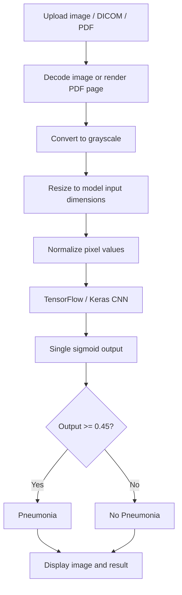

# Pneumonia Detection from Chest X-rays

A deep-learning research application that classifies chest X-ray images into **Pneumonia** and **No Pneumonia** categories using a convolutional neural network (CNN). The project combines a TensorFlow/Keras inference pipeline with a Streamlit interface for reviewing and analyzing medical images.

> **Medical disclaimer:** This is an educational/research prototype, not a medical device or clinically validated diagnostic system. Do not use its predictions to diagnose, rule out disease, make triage decisions, or guide treatment. All medical decisions must be made by qualified healthcare professionals.

## Project overview

The application accepts individual or batch uploads, decodes supported image formats, preprocesses each image to match the loaded model's input shape, and displays the original image alongside its classification output.

| Component | Implementation |
|---|---|
| Task | Binary chest X-ray image classification |
| Model framework | TensorFlow / Keras |
| Model artifact | `best_cnn_model.h5` |
| Interface | Streamlit |
| Image processing | Pillow, NumPy |
| DICOM support | pydicom |
| PDF rendering | PyMuPDF |
| Optional HEIC/HEIF | pillow-heif |
| Container | Docker |
| Deployment target | Hugging Face Spaces |

## Features

- Batch upload and inference for up to 10 files per batch.
- Side-by-side display of each uploaded image and its corresponding result.
- Support for JPG, JPEG, JPE, PNG, WEBP, BMP, TIFF, GIF, HEIC and HEIF.
- DICOM decoding for `.dcm` and `.dicom` files.
- PDF page rendering, with page selection for multi-page documents.
- Model-input-aware resizing and channel handling.
- Streamlit dashboard with upload review, progress feedback and per-file error reporting.
- Docker-based deployment configuration for Hugging Face Spaces.

## Inference workflow



## Model and preprocessing

The deployed application loads `best_cnn_model.h5` and reads the model's input dimensions at runtime. The supplied model artifact was inspected as a grayscale image model with an input shape of **128 × 128 × 1** and a single sigmoid output.

The application preprocessing currently:
1. Decodes the uploaded image (or renders the selected PDF page).
2. Converts it to grayscale.
3. Resizes it to the dimensions expected by the model.
4. Converts pixel values to floating point and divides by 255.
5. Adds the batch dimension and predicts with the Keras model.

The current app uses a decision threshold of **0.45** and interprets outputs at or above this threshold as **Pneumonia**. Confirm that the positive class mapping, preprocessing and threshold exactly match the original training and validation pipeline before making scientific claims.

### Evaluation results

No verified held-out test metrics were available in the deployed repository at the time of this update. Accuracy, precision, recall, F1-score, sensitivity, specificity and ROC-AUC are therefore intentionally not stated. Add these values only from a reproducible, leakage-aware evaluation on a separate test set.

## Repository structure

```text
Pneumonia-Detection/
├── app.py
├── best_cnn_model.h5
├── requirements.txt
├── Dockerfile
├── README.md
├── .gitattributes
├── .gitignore
└── docs/
    └── MODEL_CARD.md
```

## Run locally

### 1. Clone

```bash
git clone https://github.com/nscr45/Pneumonia-Detection.git
cd Pneumonia-Detection
```

### 2. Create a virtual environment

**Windows PowerShell**

```powershell
py -3.10 -m venv .venv
.\.venv\Scripts\Activate.ps1
```

**macOS / Linux**

```bash
python3.10 -m venv .venv
source .venv/bin/activate
```

### 3. Install dependencies and launch

```bash
python -m pip install --upgrade pip
pip install -r requirements.txt
streamlit run app.py
```

Open the local URL printed by Streamlit, normally `http://localhost:8501`.

## Run with Docker

```bash
docker build -t pneumonia-detection .
docker run --rm -p 8501:8501 pneumonia-detection
```

Then open `http://localhost:8501`.

## Hugging Face Spaces deployment

This repository uses the Docker SDK configuration and exposes Streamlit on port **8501**.

1. Create or open a Docker-based Hugging Face Space.
2. Ensure `app.py`, `requirements.txt`, `Dockerfile`, `.streamlit/config.toml` (if used), and `best_cnn_model.h5` are present.
3. Ensure the model artifact is tracked correctly with Git LFS.
4. Review the Space build and runtime logs after pushing changes.

The app searches for the model in the repository root first, under the filename `best_cnn_model.h5`.

## Responsible use and limitations

- This model is an educational research artifact and has not been established as clinically validated.
- A sigmoid score is not necessarily a calibrated clinical probability.
- The threshold and class mapping must be justified using validation data and documented.
- Model performance may vary across hospitals, scanners, patient populations, image acquisition protocols and image quality.
- DICOM pixel values can require modality-specific rescale and windowing. Validate DICOM handling against representative source files.
- PDF input is rendered page-by-page; users must select a page containing a suitable chest X-ray.
- Do not upload identifiable patient data to public services or repositories.

## Future improvements

- Add a reproducible training/evaluation notebook and document dataset provenance and licensing.
- Publish a held-out evaluation report with confusion matrix and per-class metrics.
- Add threshold analysis and calibration assessment.
- Expand DICOM handling tests for modality transforms, windowing and multi-frame studies.
- Add automated tests for image decoding, preprocessing and prediction-output validation.
- Add CI checks for syntax, dependency installation and app smoke tests.

## License and attribution

No explicit open-source license or dataset attribution was included in the repository content reviewed for this update. Add the appropriate license and dataset/research acknowledgements only after confirming the original source terms.
