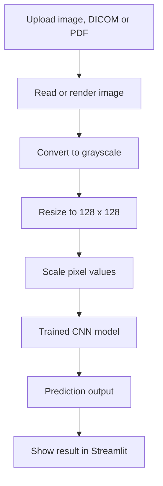

# Pneumonia Detection using CNN

I built this project to explore how deep learning can be used to classify chest X-ray images. The model predicts whether an uploaded image belongs to the **Pneumonia** or **No Pneumonia** class. I also built a Streamlit application so the model can be used through a simple interface instead of running predictions directly from a notebook.

This is a learning and portfolio project. It is not a medical diagnostic tool, and its predictions should not be used to make decisions about anyone's health.

## What the application can do

- Upload and analyse multiple files in one batch (up to 10 files).
- Preview each uploaded image before running the model.
- Display the prediction and model output alongside the corresponding image.
- Read common image formats such as JPG, JPEG, PNG, WEBP, BMP, TIFF, GIF, HEIC and HEIF.
- Accept DICOM files (`.dcm` and `.dicom`).
- Read PDF files and let the user choose which page to analyse.
- Show progress and report errors for files that could not be processed.

## Tools and libraries

| Tool | How I used it |
|---|---|
| Python | Main programming language |
| TensorFlow / Keras | Loading and running the CNN model |
| Streamlit | Building the web interface |
| NumPy | Preparing image arrays |
| Pillow | Image conversion and resizing |
| pydicom | Reading DICOM images |
| PyMuPDF | Rendering PDF pages |
| pillow-heif | Supporting HEIC and HEIF images |
| Docker | Packaging the application |
| Hugging Face Spaces | Hosting the application |

## How a prediction works

1. I upload an image, DICOM file or PDF.
2. The app reads the file and converts it into an image.
3. The image is converted to grayscale and resized to the model's input dimensions.
4. Pixel values are scaled between 0 and 1.
5. The processed image is passed to the trained CNN.
6. The app displays the model output and the predicted class.



## About the model

The model file included in this repository is `best_cnn_model.h5`. I inspected the saved model and confirmed that it accepts grayscale images with an input shape of **128 × 128 × 1** and returns a single sigmoid output.

The current application uses **0.45** as its classification threshold:

- Output of 0.45 or higher: Pneumonia
- Output below 0.45: No Pneumonia

This is how the current app is configured. The class mapping, preprocessing and threshold still need to be checked against the original training notebook and evaluation results before treating the output as a reliable measure of model performance.

## Run it on your computer

You will need Python 3.10 and the project files.

**1. Clone the repository**

```bash
git clone https://github.com/nscr45/Pneumonia-Detection.git
cd Pneumonia-Detection
```

**2. Create and activate a virtual environment**

Windows PowerShell:

```powershell
py -3.10 -m venv .venv
.\.venv\Scripts\Activate.ps1
```

macOS / Linux:

```bash
python3.10 -m venv .venv
source .venv/bin/activate
```

**3. Install the libraries and start the app**

```bash
python -m pip install --upgrade pip
pip install -r requirements.txt
streamlit run app.py
```

Streamlit will print a local address in the terminal. Open it in your browser, usually at `http://localhost:8501`.

## Run using Docker

If you prefer Docker, build and start the application with:

```bash
docker build -t pneumonia-detection .
docker run --rm -p 8501:8501 pneumonia-detection
```

Then open `http://localhost:8501`.

## Project structure

```text
Pneumonia-Detection/
├── app.py
├── best_cnn_model.h5
├── requirements.txt
├── Dockerfile
├── README.md
├── .gitattributes
├── .gitignore
└── docs/
    └── MODEL_CARD.md
```

## What I want to improve next

There are a few things I would like to work on next:

- Evaluate the model on a separate test set and report the confusion matrix, precision, recall, F1-score, sensitivity, specificity and ROC-AUC.
- Add plots showing training and validation performance.
- Check that the preprocessing and class mapping in the app match the original training code.
- Test the DICOM pipeline with different image types and metadata.
- Add automated tests for image loading and prediction.
- Improve the app based on testing with different valid and invalid uploads.

I have not added accuracy or other performance numbers here because I do not want to publish metrics without verifying them against the actual evaluation results.

## A note on medical use

This project is for learning and demonstration. A model output is not a diagnosis, and a sigmoid score should not automatically be interpreted as a clinically meaningful probability. The model has not been established as clinically validated. Please do not use it to make healthcare or treatment decisions.

## License and dataset details

I still need to confirm the original dataset source, its terms of use and the appropriate project license before adding those details here.
